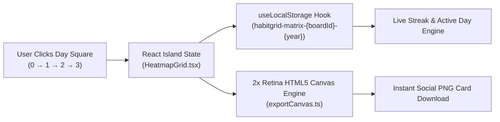

<div align="center">

# 🟩 HabitGrid

### 365-Day Zero-Server Habit Tracker

[](https://habit-grid.github.io)
[](https://astro.build)
[](https://react.dev)
[](https://tailwindcss.com)
[](https://habit-grid.github.io)
[](https://ko-fi.com/kishara)

**HabitGrid** is a 100% client-side, ultra-minimal web application built with **Astro** and **React Islands** that enables users to build and visualize daily habits on a GitHub-style **365-day contribution heatmap**. All habit boards, streak calculations, and multi-year grids are persisted exclusively in the user's browser via `LocalStorage`—**zero server uploads, zero accounts, and instant high-DPI PNG export.**

[Launch HabitGrid](https://habit-grid.github.io) · [Report an Issue](https://github.com/habit-grid/habit-grid.github.io/issues) · [Support the Developer](https://ko-fi.com/kishara)

</div>

---

## ✨ Key Features

- **🔒 100% Zero-Server Privacy (`useLocalStorage`):** Every habit board and daily intensity square is saved immediately in `window.localStorage`. Reloading the page restores your exact 365-day grid pattern with zero cloud accounts or server requests.
- **📊 GitHub-Style 365-Day Contribution Matrix:**
  - Click any day square to cycle smoothly through **4 custom activity intensity levels (`0 → 1 → 2 → 3 → 0`)**.
  - Real-time **Current Streak (`🔥`)** and **Active Days (`active/365`)** tracking.
- **➕ Multi-Habit Boards & Multi-Year Isolation:**
  - Create unlimited habit boards (`+ New Habit`), switch between habits in one click, rename habits inline, or remove extra boards.
  - Switch across the **Current Year (`2026`)** and **Future Years (`2027`, `2028`, `2029`, `2030`)** with each `(habitId, year)` matrix isolated safely in `LocalStorage`.
- **📱 Adaptive Desktop & Mobile/Tablet Views:**
  - **Desktop (`lg+`):** Classic expansive 53-week × 7-day horizontal GitHub contribution heatmap.
  - **Tablet & Mobile (`< lg`):** Device-fitted **vertical 12-month calendar grid** (`2 columns` on phones, `3 columns` on tablets) for natural vertical scrolling with zero horizontal overflow, paired with an icon-only top navbar.
- **🖼️ High-DPI HTML5 Canvas PNG Export:**
  - Click **Download Graph** to invoke a native 2× Retina HTML5 `<canvas>` renderer (`src/utils/exportCanvas.ts`) that exports your complete 53-week heatmap, habit title, streak KPIs, and 4-color legend as a clean, shareable `.png` card.
- **🌍 7-Language Instant Localization & 100% Technical SEO:**
  - Instant zero-reload localization for **English (`US`)**, **Español (`ES`)**, **Português (`BR`)**, **Deutsch (`DE`)**, **Français (`FR`)**, **日本語 (`JP`)**, and **简体中文 (`CN`)**.
  - Complete single-page canonical SEO (`https://habit-grid.github.io/`), `1200×630` `og-image.png`, `hreflang` alternates, semantic Breadcrumb Microdata, and a 5-entity JSON-LD `@graph` (`WebSite`, `SoftwareApplication`, `BreadcrumbList`, `HowTo`, `FAQPage`).

---

## 🏗️ System Architecture & Data Flow



---

## 🎨 Design System & 4-Level Heatmap Palette

HabitGrid features an ultra-minimal aesthetic with **Light Mode** (`#FCFBF7` default), **Dark Mode** (`#041821`), a subtle animated background of varied habit cells, and a custom 4-tier activity intensity palette:

| Intensity Level | Token Name | Hex | Preview | Meaning |
| :--- | :--- | :--- | :---: | :--- |
| **Level 0** | `level_0_empty` | `#FFEFC4` |  | Empty / Unlogged day square & warm CTA highlights |
| **Level 1** | `level_1_low` | `#97D7FF` |  | Low activity intensity & subtle surface accents |
| **Level 2** | `level_2_medium` | `#4D8DBA` |  | Medium activity intensity & interactive borders |
| **Level 3** | `level_3_high` | `#086288` |  | High activity intensity, primary brand headings & buttons |

---

## 📂 Project Structure

```text
habit-grid.github.io/
├── .github/
│   └── workflows/
│       └── deploy.yml             # Automated GitHub Pages CI/CD workflow
├── public/
│   ├── favicon.svg                # 4-color HabitGrid vector favicon
│   ├── og-image.png               # 1200×630 raster OpenGraph social preview image
│   ├── og-image.svg               # Vector OpenGraph source artwork
│   ├── robots.txt                 # Search crawler directives
│   ├── site.webmanifest           # Progressive Web App manifest
│   └── sitemap.xml                # Canonical XML sitemap with 7 hreflang alternates
├── src/
│   ├── components/
│   │   ├── AppPage.astro          # Ultra-minimal page shell, animated background cells & SEO drawer
│   │   ├── HeatmapGrid.tsx        # React Island: Multi-habit 365-day heatmap (Desktop + Mobile vertical)
│   │   └── Navbar.astro           # Sticky navbar (strict icon-only layout on mobile/tablet)
│   ├── hooks/
│   │   └── useLocalStorage.ts     # Custom React hook for instant LocalStorage sync & year isolation
│   ├── i18n/
│   │   ├── translations.ts        # Type-safe 7-language dictionary & helpers
│   │   └── *.json                 # Localized JSON dictionaries (en, es, pt, de, fr, ja, zh)
│   ├── layouts/
│   │   └── Layout.astro           # HTML shell, gtag.js, OpenGraph, hreflang & 5-entity JSON-LD @graph
│   ├── pages/
│   │   └── index.astro            # Canonical single-page root entrypoint (https://habit-grid.github.io/)
│   ├── styles/
│   │   └── global.css             # Tailwind directives, card surfaces & background cell pulse animation
│   └── utils/
│       └── exportCanvas.ts        # 2× Retina HTML5 2D Canvas PNG heatmap card generator
├── astro.config.mjs               # Astro SSG, React, Tailwind & i18n configuration
├── tailwind.config.mjs            # Custom habit palette (#FFEFC4, #97D7FF, #4D8DBA, #086288) & themes
├── tsconfig.json                  # Strict TypeScript configuration
└── package.json                   # Project dependencies and scripts
```

---

## 🚀 Getting Started

### Prerequisites

- **Node.js** `>= 18.17.1` (Node `20+` or `24+` recommended)
- **npm** `>= 9.0.0`

### Installation & Local Development

1. **Clone the repository:**
   ```bash
   git clone https://github.com/habit-grid/habit-grid.github.io.git
   cd habit-grid.github.io
   ```

2. **Install dependencies:**
   ```bash
   npm install
   ```

3. **Start the development server:**
   ```bash
   npm run dev
   ```
   Open `http://localhost:4321` in your browser.

4. **Build for production:**
   ```bash
   npm run build
   ```
   Static production files are generated in the `./dist` directory.

5. **Preview the production build locally:**
   ```bash
   npm run preview
   ```

---

## 🌐 Internationalization (i18n) & Technical SEO

HabitGrid supports 7 languages on the single canonical root URL (`https://habit-grid.github.io/`) with instant client-side switching and `hreflang` indexing:

| Code | Badge | Language | URL | Target SEO Keywords |
| :---: | :---: | :--- | :--- | :--- |
| `en` | 🇺🇸 `US` | **English** | `https://habit-grid.github.io/` | `habit tracker`, `github contribution heatmap`, `365 day habit grid`, `localstorage habit tracker` |
| `es` | 🇪🇸 `ES` | **Español** | `https://habit-grid.github.io/?lang=es` | `rastreador de hábitos`, `mapa de calor github`, `hábitos 365 días` |
| `pt` | 🇧🇷 `BR` | **Português** | `https://habit-grid.github.io/?lang=pt` | `rastreador de hábitos`, `mapa de calor github`, `hábitos 365 dias` |
| `de` | 🇩🇪 `DE` | **Deutsch** | `https://habit-grid.github.io/?lang=de` | `Gewohnheitstracker`, `GitHub Heatmap`, `365 Tage Gewohnheiten` |
| `fr` | 🇫🇷 `FR` | **Français** | `https://habit-grid.github.io/?lang=fr` | `suivi des habitudes`, `carte thermique github`, `grille 365 jours` |
| `ja` | 🇯🇵 `JP` | **日本語** | `https://habit-grid.github.io/?lang=ja` | `習慣トラッカー`, `GitHub風ヒートマップ`, `365日習慣カレンダー` |
| `zh` | 🇨🇳 `CN` | **简体中文** | `https://habit-grid.github.io/?lang=zh` | `习惯追踪器`, `GitHub热力图`, `365天习惯打卡` |

---

## ☕ Support the Developer

If you find **HabitGrid** helpful for building daily streaks in complete privacy, consider supporting ongoing development:

<a href="https://ko-fi.com/kishara" target="_blank" rel="noopener noreferrer">
  
</a>

---

## 📄 License

Distributed under the **MIT License**. See [LICENSE](./LICENSE) for full details.
